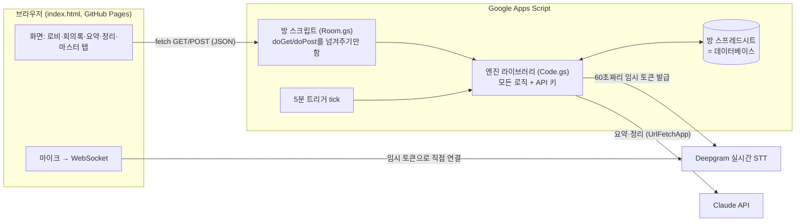

# 🎲 TRPG Archive

TRPG(주로 크툴루의 부름) 온라인 세션을 **말하면 기록되고, 기록은 이야기가 되는** 도구로 만든 웹앱입니다.

- 플레이어 각자 브라우저 마이크로 말하면 실시간으로 받아써서 회의록이 쌓입니다.
- 5분마다 AI가 회의록을 읽고 줄거리 요약, NPC·장소·단서 정리, 다음 할 일을 갱신합니다.
- 마스터(키퍼)는 시나리오 자료를 넣어 두고 NPC 대사, 판정 도움, 단서 보드, 지난 회차 요약 같은 도구를 씁니다. 이 자료는 플레이어 쪽 응답에 절대 섞이지 않습니다.

사이트: https://praypeace.github.io/TRPG_Archive/

> 서버가 따로 없습니다. **정적 페이지(GitHub Pages) + Google Apps Script 웹 앱 + Google 스프레드시트**가 전부입니다.

---

## 구조 한눈에



### 1. 화면: `index.html` + `css/` + `js/`

- 빌드 도구 없이 HTML 하나에 CSS 하나, 기능별 JS 일곱 개를 순서대로 불러옵니다. JS 파일들은 이름(함수·변수)을 함께 쓰므로 순서가 중요합니다(`core` → `room` → `export` → `live` → `keeper` → `lobby` → `main`). 불러오는 순간 실행되는 코드는 앞쪽 파일의 함수만 부르게 하고, 그런 코드는 `main.js`에 둡니다. GitHub Pages가 그대로 서빙합니다.
- 판을 올릴 때 `index.html`의 `?v=` 값도 같이 올려 브라우저가 새 파일을 받게 합니다.
- 서버와는 Apps Script 웹 앱 주소(`https://script.google.com/macros/s/…/exec`)로 `fetch` 합니다. 읽기·쓰기 모두 POST이고(비밀번호가 주소에 남지 않게), 본문은 JSON 문자열이며 `{ action: '...', pw | kt, ... }` 꼴입니다. CORS 사전 요청(preflight)을 피하려고 `Content-Type`을 따로 지정하지 않습니다.
- 첫 화면은 휴대폰 모양의 **로비**입니다. 방 목록은 `lobby.json`의 로비 방 주소에서 받아 옵니다.
- 내보내기(txt·docx·hwpx)는 브라우저 안에서 직접 ZIP을 만들어 저장합니다(`export/hwpx/`는 한글 문서 뼈대).

### 2. 서버: Google Apps Script

**방 하나 = 스프레드시트 하나 = 웹 앱 배포 하나**입니다.

- 시트가 곧 DB입니다. 탭 이름: `설정`(키-값), `대화`(회의록 줄), `요약`, `정리`(NPC·장소·단서 JSON), `캐릭터`, `이미지`, `토큰기록`, 마스터 전용 `키퍼자료`·`키퍼원문`·`키퍼기록`·`판정기록`.
- 동시 쓰기는 `LockService`, 짧은 값은 `CacheService`로 처리합니다.
- `tick()`을 5분 시간 트리거로 돌려 새 대화를 모아 Claude에 요약을 맡깁니다. 새 대화가 적으면 건너뛰어 비용을 아낍니다(`SUM_MIN_CHARS`, `SUM_MAX_WAIT`).

**라이브러리 방식**: 방이 여러 개라 코드를 방마다 붙여 넣으면 업데이트가 힘들어서 이렇게 나눴습니다.

| 파일 | 어디에 | 하는 일 |
|---|---|---|
| `Code.gs` | "엔진" Apps Script 프로젝트 **하나** | 모든 로직, API 키. 라이브러리로 공개(식별자 `TRPG`) |
| `Room.gs` | 방마다 시트에 붙은 스크립트 | `doGet`/`doPost`/`tick` 등을 `TRPG.*`로 넘기는 20줄짜리 연결 코드 |

- 방은 라이브러리를 **HEAD(개발 모드)**로 참조하므로 엔진의 `Code.gs`만 저장하면 모든 방에 바로 반영됩니다. 재배포가 필요 없습니다.
- 라이브러리 안에서 `SpreadsheetApp.getActive()`는 호출한 방의 시트를 가리킵니다. 반면 `CacheService`와 스크립트 속성은 엔진 하나를 모든 방이 공유하므로 캐시 키에 시트 ID를 붙여 방끼리 섞이지 않게 했습니다(`roomCache()`). 잠금은 웹 요청과 트리거가 같은 것을 잡도록 스크립트 잠금 하나를 씁니다.

### 3. 외부 AI

- **Deepgram** (실시간 받아쓰기): 키를 브라우저에 주지 않습니다. 서버가 `/v1/auth/grant`로 **60초짜리 임시 토큰**을 받아 주고, 브라우저는 그 토큰으로 `wss://api.deepgram.com/v1/listen`에 직접 붙습니다. 이때 용어집·NPC·장소 이름을 keyterm으로 같이 보내 고유명사 인식을 높입니다.
- **Claude** (요약·정리·마스터 도구): 서버의 `UrlFetchApp`에서만 호출합니다. 요약은 `claude-sonnet-5-5`, 자동 정리는 싼 `claude-haiku-5-5`를 씁니다. 바뀌지 않는 앞부분은 프롬프트 캐싱을 걸고, 호출마다 `토큰기록` 시트에 사용량을 남깁니다.

---

## 보안 모델

- **API 키는 저장소에 없습니다.** `Code.gs` 맨 위 네 줄(`CLAUDE_KEY`, `DEEPGRAM_KEY`, `ROOM_PW`, `KEEPER_PW`)은 자리표시자이고, 실제 값은 엔진 Apps Script 프로젝트 안에만 넣습니다. 브라우저로 키가 내려가는 경로도 없습니다(Deepgram은 60초 임시 토큰만).
- **방 비밀번호**: 플레이어 모두가 아는 값. 읽기·쓰기 요청마다 확인합니다.
- **마스터 비밀번호**: 로그인하면 마스터 토큰(`kt`)을 받고, 서버에는 해시만 보관합니다. 로비에서 바꾸면 `설정` 탭의 `salt:sha256` 해시가 코드 값보다 우선합니다.
- **마스터 자료 격리**: 플레이어에게 가는 응답과 공개 기록용 AI 작업(요약·정정 등)은 `publicAi()` 안에서 돌고, 그 안에서 마스터 시트를 읽으려 하면 오류가 나도록 막았습니다. 시나리오 비밀이 요약에 섞일 수 없게 하려는 장치입니다.
- 스프레드시트는 마스터 구글 계정에만 둡니다(공유하면 마스터 시트가 보이므로).

---

## 직접 띄워 보기

1. 구글 시트를 하나 만들고 확장 프로그램 → Apps Script에 `Code.gs`를 붙여 넣습니다. 맨 위 네 줄에 본인 키와 비밀번호를 넣습니다.
   - 방이 하나뿐이면 라이브러리 없이 이렇게 단독으로 써도 됩니다.
2. 함수 `setup` 실행 → 권한 허용 (시트 탭과 5분 트리거를 만듭니다).
3. 배포 → 새 배포 → 웹 앱 / 실행: 나 / 액세스: 모든 사용자 → 나온 `/exec` 주소를 복사합니다.
4. 사이트에서 "주소로 직접 입장"에 그 주소와 방 비밀번호를 넣습니다. (자기 저장소로 포크했다면 `lobby.json`의 `hub`를 자기 로비 방 주소로 바꿉니다.)
5. (선택) 함수 `selfTest`는 시트 동작을, `selfTestCore`는 비용 계산·마스터 자료 격리·요약 건너뛰기 규칙을(AI 호출 없음), `selfTestAi`는 Claude·Deepgram 연결을 점검합니다.

방을 여러 개 쓰려면 `Code.gs`를 엔진 프로젝트에 두고 라이브러리로 배포한 뒤, 방마다 `Room.gs`만 붙이고 라이브러리 `TRPG`(HEAD)를 추가합니다. 자세한 순서는 `Code.gs` 맨 위 주석에 있습니다.

## 파일

```
index.html        화면 뼈대(HTML). 아래 css·js를 불러온다
css/app.css       모든 화면 스타일
js/core.js        공통 도구 · 설정 · 서버 요청 · 입장 · 탭 · 창
js/room.js        방 화면: 회의록 · 형광펜 · 참여자 · 요약/정리 · 단서 · 북마크 · 다음 할 일 · 방 테마
js/export.js      내보내기 (txt · docx · hwpx)
js/live.js        주기적으로 읽기 · 받아쓰기 · 알림 · 설정 탭
js/keeper.js      마스터 도구 · 마스터 전용 탭 (APP_VER가 여기 있음)
js/lobby.js       로비(폰 화면) · 잠금 해제 컷인
js/main.js        시작
Code.gs           Apps Script 엔진 (API, 시트 DB, AI 호출, 트리거)
Room.gs           방 시트에 붙이는 연결 코드
lobby.json        사이트 첫 화면이 열 로비 방 주소
export/hwpx/      한글(.hwpx) 내보내기 뼈대 (python-hwpx, Apache-2.0)
og.png, icon.png  링크 미리보기 썸네일, 아이콘
```

`Code.gs`의 `CODE_VER`와 `js/keeper.js`의 `APP_VER`(그리고 `index.html`의 `?v=`)는 항상 같게 올립니다. 다르면 마스터 탭에 알림이 뜹니다.
